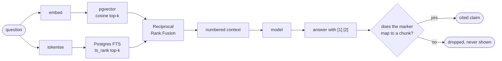

<p align="center">
  <picture>
    <source media="(prefers-color-scheme: dark)" srcset="assets/terminal-dark.svg">
    <source media="(prefers-color-scheme: light)" srcset="assets/terminal-light.svg">
    
  </picture>
</p>

<p align="center">
  <a href="https://www.linkedin.com/in/cavini"></a>
  
</p>

---

I'm **Arthur Cavini**, and I build **AI systems whose answers can be checked** — retrieval that cites the
passage it came from, counts that come out of SQL rather than out of a model,
and judges told to refuse when they are not sure.

The rest is the boring part done properly: TypeScript everywhere, clean
architecture, a spec before the code, and a decision record for anything that
would otherwise be argued about twice.

<br>

## `~/work` — what I've shipped lately

### [`docpilot`](https://github.com/cavini/docpilot) · RAG with citations you can click

<p>
  
  
  
  
  
  
</p>

Ask a question about your documentation; get an answer where **every claim
links to the passage it came from** — document, heading path, page, snippet.
Also exposes an MCP server, so Claude Code or Cursor can search the knowledge
base without leaving the editor.



> **The hard part.** An answer that merely *sounds* right is worse than an
> error, because nobody checks it. So retrieval is hybrid — an exact function
> name has to be found as reliably as a paraphrase — every claim is traced back
> to a chunk before it is rendered, and the model is told to say it does not
> know when the context will not support an answer. Then that refusal is
> **measured** in the eval set rather than hoped for.

<details>
<summary><b>More</b> — evals, guardrails, and a test suite that needs no API key</summary>

<br>

- **Hybrid retrieval.** pgvector cosine similarity and Postgres full-text
  search run in parallel, fused with Reciprocal Rank Fusion.
- **Chunking that respects structure** — headings and code blocks are not split
  down the middle, and the heading path travels with the chunk so a citation
  can say *where* in the document it came from.
- **A tool-calling agent** with a step limit, and explicit approval before
  anything with a side effect.
- **Structured extraction** validated against Zod schemas, with a repair pass
  when the model returns something invalid.
- **Evals, not vibes.** Hit-rate@k and MRR for vector-only, FTS-only and
  hybrid; faithfulness scored by LLM-as-judge against a written rubric;
  refusal correctness; latency p50/p95; cost per question.
- **Guardrails.** Rate limits, input and output caps, prompt-injection
  mitigations, approval gates on side effects.
- **Every model call logs its tokens and cost** to an `llm_usage` table.
- **The whole test suite runs with no API keys** — deterministic model doubles
  are wired in through the same provider factory production uses, so the tests
  exercise the real code path.
- Six test levels: unit, integration against real Postgres and Redis via
  Testcontainers, API end-to-end, contract tests against the OpenAPI spec,
  component tests in a real browser, and Playwright.

</details>

<br>

### [`overtone`](https://github.com/cavini/overtone) · podcast analytics, and an argument against RAG

<p>
  
  
  
  
  
</p>

Upload an episode; find out how often the running jokes actually came up, which
words you cannot stop saying, and how that is changing across the series — with
a timestamped quote behind every number. Brazilian Portuguese throughout.
Hosted, and **$0 to run**: three free tiers, no credit card anywhere.

> **The hard part.** [ADR 0007](https://github.com/cavini/overtone/blob/main/docs/adr/0007-assistant-is-tool-use-not-rag.md)
> argues the assistant should *not* be RAG. Top-k retrieval returns a **sample**,
> so a model asked "how many times did we say that?" counts the sample and
> reports a number that is confidently, invisibly wrong — the worst failure a
> measurement product can have. Instead the model's whole job is compiling the
> question into a `Query` object and narrating the result; **SQL does the
> arithmetic**. Hallucinated numbers become structurally impossible, every
> answer decomposes into loggable tool calls, and the cost per question drops
> from roughly \$3.25 to \$0.03. Knowing when *not* to reach for RAG is the
> part of this I would most like to be asked about.

<details>
<summary><b>More</b> — Whisper at 160× realtime, pt-BR linguistics, 35 ADRs</summary>

<br>

- **No worker, no queue, no Docker.** Groq transcribes at ~160× realtime, so an
  episode comes back inside a normal web request.
- **The audio never passes through the server.** A serverless function accepts
  about 4.5 MB of body, so the browser decodes the file, splits it on a chunk
  plan that cuts in silences rather than mid-word, and uploads each piece
  straight to object storage.
- **Paced against the provider's allowance**, which refills continuously rather
  than resetting hourly — so a two-hour episode finishes in minutes instead of
  failing at the rate limit.
- **Brazilian Portuguese lemmatisation** done properly: diacritics preserved,
  enclitics split, dictionary before stemmer, and a hand-written override list
  for the words a general dictionary gets right about the language and wrong
  about how people actually talk.
- **35 ADRs, including three reversals kept on the record** — a decision that
  turned out wrong is worth more written down than erased.
- Clean architecture with the layering enforced in CI by `dependency-cruiser`,
  not by good intentions.

</details>

<br>

### [`precinho`](https://github.com/cavini/precinho) · an LLM judge where a wrong answer costs money

<p>
  
  
  
  
  
</p>

Compare grocery prices across Brazilian supermarket chains for **your** postcode
— prices here are regional, so the same chain charges different amounts
depending on which branch serves your address. Measured on real data, the gap
between two São Paulo chains on the same barcode was **30%**.

> **The hard part.** Products are matched on a GS1-verified barcode normalised
> to 14 digits. Where no barcode exists, Claude judges whether two chains'
> product names are the same product — and the prompt is written against the
> pairs a string-similarity heuristic actually got wrong, because *"Bolo de
> Brigadeiro"* and *"Bolo de Brigadeiro com Amêndoas"* share every word but one,
> and that word is the product. **The judge is told to answer `false` when
> unsure:** a missed match costs a duplicate row, which somebody notices; a
> wrong merge quotes a shopper the price of something they are not buying,
> which nobody does.

<details>
<summary><b>More</b> — append-only pricing, two-tier rate limiting, contract tests</summary>

<br>

- **Offers are append-only.** A store's current price is its most recent row,
  which makes price history a by-product rather than a second feature.
- **Out-of-stock prices never win a comparison**, and price per litre or kilo is
  computed — a 350 ml can at R$ 3,99 is cheaper than a 2 L bottle and twice the
  price per litre.
- **Rate limiting as two separate problems.** The query itself is capped in
  tokens, because every token becomes a database predicate and the attack lands
  on the database, not the API; volume is a token bucket, with a fast in-memory
  limiter in front of a shared Postgres one so the limit is real across
  serverless instances. Caller addresses are hashed with a per-deployment salt
  and never stored raw.
- **100% line coverage on the domain and application layers** — a threshold that
  has already caught a layering mistake and a real bug.
- **Contract suites every implementation of a port must pass.** The in-memory
  and Postgres rate limiters are held to the same one, which is the only thing
  that stops them drifting.
- Integration tests run against payloads recorded from the live store and
  postcode APIs — which is why the mapping survives an 8-digit barcode, a
  `Price: 0` meaning *unlisted*, and an API returning the **string** `"true"`
  where a boolean was documented.

</details>

<br>

## `~/skills` — claims, with the receipts attached

| What I can do | Where it actually lives |
| --- | --- |
| Hybrid retrieval — vector + full-text, fused with RRF | `docpilot` · ADR 0006 |
| Chunking that respects headings and code blocks | `docpilot` · ADR 0005 |
| Citations resolved back to chunks, invalid markers dropped | `docpilot` |
| Retrieval evals — hit-rate@k, MRR, faithfulness, refusal correctness | `docpilot/evals` |
| LLM-as-judge with a written rubric and a refuse-when-unsure rule | `precinho`, `docpilot` |
| Tool-calling agents — step limits, approval gates, replayable calls | `docpilot`, `overtone` |
| MCP server consumed by Claude Code and Cursor | `docpilot` |
| Structured output against Zod schemas, with a repair pass | `docpilot` |
| Prompt caching on the stable system + tool prefix | `overtone` · ADR 0007 |
| Speech-to-text pipeline — Whisper, word-level timestamps, chunk planning | `overtone` |
| Token and cost accounting per model call | `docpilot` · `llm_usage` |
| Deterministic model doubles, so CI needs no API keys | `docpilot`, `overtone` |

<br>

## `~/stack`

<table>
<tr><td><b>AI&nbsp;/&nbsp;LLM</b></td><td>


</td></tr>
<tr><td><b>Front&nbsp;end</b></td><td>


</td></tr>
<tr><td><b>Back&nbsp;end</b></td><td>


</td></tr>
<tr><td><b>Testing</b></td><td>


</td></tr>
<tr><td><b>Platform</b></td><td>


</td></tr>
</table>

<br>

## `~/how-i-work`

<details>
<summary>Open — the loop I actually follow, and why</summary>

<br>

**The spec comes first, and it is committed first.** Numbered acceptance
criteria, and each criterion's number appears in the name of the test that
proves it — so `grep -r AC3` finds the requirement, the test and the code in
one go.

**Then the failing test, and I watch it fail.** A test that has never been red
has proved nothing.

**Every increment ships end to end.** If stopping after a slice would leave a
user with nothing, the slice is cut wrong. No waterfall, no six-week branch.

**A decision record for anything that would otherwise be argued about twice** —
48 of them across these projects, *including the ones that were reversed*. A
wrong turn is worth more on the record than erased, because the next person
(usually me) will otherwise take it again.

**Clean architecture and SOLID, enforced rather than aspired to.** Dependencies
point inward; the domain imports nothing. In `overtone` that rule is checked in
CI by `dependency-cruiser`, because a layering rule nobody checks is a comment.

**Coverage thresholds that bite** — 100% lines on domain and application layers
in `precinho`, which has already caught a layering mistake and a real bug.

**Big O written down where it matters**, and database work judged by buffers
read rather than by wall-clock on a warm cache.

</details>

<br>

## `~/currently`

```
▸ fine-tuning            LoRA / PEFT — and, more interestingly, learning where
                         it genuinely beats retrieval and where it is just a
                         more expensive way to be wrong
▸ rerankers              cross-encoder reranking, measured against the RRF
                         baseline rather than assumed to beat it
▸ agent evals            scoring trajectories, not just final answers
```

<br>

---

<p align="center">
  <a href="https://www.linkedin.com/in/cavini"></a>
  &nbsp;
  <a href="https://github.com/cavini?tab=repositories"></a>
</p>

<p align="center"><sub><i>Counts come from SQL. The model phrases; it does not do arithmetic.</i></sub></p>
