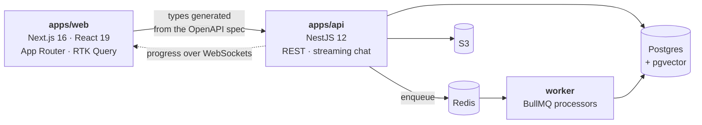

<p align="center">
  <picture>
    <source media="(prefers-color-scheme: dark)" srcset="assets/terminal-dark.svg">
    <source media="(prefers-color-scheme: light)" srcset="assets/terminal-light.svg">
    
  </picture>
</p>

<p align="center">
  <a href="https://www.linkedin.com/in/cavini"></a>
  
  
</p>

---

I'm **Arthur Cavini**, a full-stack engineer. **MERN** is the backbone — React
on the front, Node and Express behind it, MongoDB underneath — and **NestJS** is
where the Node side goes when a project outgrows a single Express app: modules,
dependency injection, guards and interceptors, so a cross-cutting rule is
written once instead of in every handler.

Most of what I ship now is **React and Next.js** against a typed API, with
**Supabase** or Postgres when I want the database to do the work. TypeScript end
to end, tested at every level, with a decision record left behind so the next
person does not have to guess.

More recently that has included **AI features** — retrieval with citations, a
tool-calling agent, an LLM used as a judge — built the same way as everything
else, which is to say measured rather than trusted.

<br>

## `~/experience`

<table>
<tr><td valign="top"><b>React</b></td><td>

React 16 → 19, class components through hooks. **Redux** and **Redux Toolkit**,
React Router, Vite and CRA, Tailwind and styled-components. Shared component
libraries documented in **Storybook**, so a button has one definition and every
state of it is written down.

</td></tr>
<tr><td valign="top"><b>Node&nbsp;·&nbsp;Express&nbsp;·&nbsp;Mongo</b></td><td>

**Express + Mongoose** REST APIs with JWT auth — the classic MERN shape — and
the same stack at size: a warehouse-management platform split across roughly
seven **NestJS** services on MongoDB (auth, users, inventory, orders, receipts,
customers), behind a React + Redux Toolkit front end, with a shared component
package and a mobile client over the same APIs.

</td></tr>
<tr><td valign="top"><b>NestJS</b></td><td>

From **Nest 8 with TypeORM** through **Nest 12 with Drizzle**. Zod-validated
configuration that fails at startup rather than on a request, typed domain
errors behind a global exception filter, WebSocket gateways, BullMQ workers, and
OpenAPI generated from the code so the front end's types are not hand-written.

</td></tr>
<tr><td valign="top"><b>Next.js</b></td><td>

**13 → 16**, Pages Router through App Router and React Server Components.
Commerce front ends, a price-comparison site that server-renders per region, and
an App Router + NestJS monorepo whose client types are generated from the
OpenAPI spec. Bilingual throughout with `next-intl`.

</td></tr>
<tr><td valign="top"><b>Supabase</b></td><td>

Postgres, row-level security, storage and magic-link auth on the free tier —
including direct-to-storage uploads that bypass the serverless body limit, and
append-only tables where history is a by-product of how the data is written
rather than a second feature.

</td></tr>
</table>

<br>

## `~/work` — what I've shipped lately

### [`docpilot`](https://github.com/cavini/docpilot) · a NestJS + Next.js monorepo, end to end

<p>
  
  
  
  
  
  
</p>

A documentation assistant, and the project where I build the whole shape:
**NestJS** API and worker, **Next.js 16 / React 19** front end, **Drizzle** over
Postgres, **Redis + BullMQ** for ingestion, S3 for the originals, a **Storybook**
design system, English and Portuguese throughout.



> **What I'd want to be asked about.** Upload is idempotent on the SHA-256 of
> the *content*, so a client retrying after a timeout gets `200` and the
> existing document rather than a duplicate or a `409`. The declared
> `Content-Type` is treated as a claim rather than a fact — the file's own
> signature is checked first, because a `.md` routinely arrives as
> `application/octet-stream`. Ingestion progress is pushed over WebSockets
> instead of polled.

<details>
<summary><b>More</b> — the AI half, and the test pyramid</summary>

<br>

Shipped through **M4 of nine**. M5 onward — an MCP server, evals, guardrails,
cost logging, GraphQL, deployment — is specced but **not built yet**, and the
roadmap in the repo says which is which.

**The retrieval half.** A question is embedded and run through two searches at
once — pgvector cosine similarity and Postgres full-text — and the two ranked
lists are fused with Reciprocal Rank Fusion, so an exact function name is found
as reliably as a paraphrase. The best chunks become numbered context, and the
model is instructed to cite them and to say it does not know when they will not
support an answer.


A citation marker that does not resolve to a real chunk is **dropped rather than
rendered** — an answer that merely *sounds* right is worse than an error,
because nobody checks it.

- **Chunking that respects structure** — headings and code blocks are not split
  down the middle, and the heading path travels with the chunk, so a citation
  can say *where* in the document it came from.
- **A tool-calling agent** (`POST /agent`) with four tools, a step limit, and
  approval before anything irreversible — the loop will not create a ticket
  until the reader answers, and the test proves the denial by counting rows
  rather than by reading the model's reply.
- **Structured extraction** against a server-held schema registry, validated
  with Zod.
- **The whole test suite runs with no API keys** — deterministic model doubles
  are wired in through the same provider factory production uses, so the tests
  exercise the real code path.
- Unit, integration against real Postgres and Redis via Testcontainers, API
  end-to-end, contract tests against the OpenAPI spec, component tests in a real
  browser, and Playwright.

</details>

<br>

### [`precinho`](https://github.com/cavini/precinho) · Next.js 16, React 19, Supabase

<p>
  
  
  
  
  
</p>

Compare grocery prices across Brazilian supermarket chains for **your** postcode
— prices here are regional, so the same chain charges different amounts
depending on which branch serves your address. On the same barcode, the gap
between two São Paulo chains measured **30%**. Server-rendered per region, with
a nightly collector in GitHub Actions rather than on Vercel, because a sweep
takes minutes and a Hobby function is capped at sixty seconds.

> **What I'd want to be asked about.** Four layers with dependencies pointing
> inward only, and the postcode lives in a **cookie rather than the database** —
> there is no login, so there is nobody for a stored preference to belong to,
> and a cookie is readable during server rendering, so the first paint already
> shows the right region. Offers are **append-only**: a store's current price is
> simply its most recent row, which makes price history a by-product instead of
> a second feature.

<details>
<summary><b>More</b> — matching products, rate limiting, contract tests</summary>

<br>

- **Products are matched on a GS1-verified barcode** normalised to 14 digits, so
  a store reporting EAN-13 and one reporting GTIN-14 land on the same product.
  Anything without a verifiable barcode stays store-local.
- **Where no barcode exists, Claude judges whether two names are the same
  product**, prompted against the pairs a string-similarity heuristic actually
  got wrong — *"Bolo de Brigadeiro"* and *"Bolo de Brigadeiro com Amêndoas"*
  share every word but one, and that word is the product. The judge is told to
  answer `false` when unsure: a missed match costs a duplicate row, which
  somebody notices; a wrong merge quotes a shopper the price of something they
  are not buying, which nobody does.
- **Out-of-stock prices never win a comparison**, and price per litre or kilo is
  computed — a 350 ml can at R$ 3,99 is cheaper than a 2 L bottle and twice the
  price per litre.
- **Rate limiting as two separate problems.** The query itself is capped in
  tokens, because every token becomes a database predicate and the attack lands
  on the database, not the API; volume is a token bucket, with a fast in-memory
  limiter in front of a shared Postgres one so the limit is real across
  serverless instances. Caller addresses are hashed with a per-deployment salt
  and never stored raw.
- **100% line coverage on the domain and application layers** — a threshold that
  has already caught a layering mistake and a real bug.
- **Contract suites every implementation of a port must pass.** The in-memory
  and Postgres rate limiters are held to the same one, which is the only thing
  that stops them drifting.
- Integration tests run against payloads recorded from the live store and
  postcode APIs — which is why the mapping survives an 8-digit barcode, a
  `Price: 0` meaning *unlisted*, and an API returning the **string** `"true"`
  where a boolean was documented.

</details>

<br>

### [`overtone`](https://github.com/cavini/overtone) · a TypeScript monorepo running on free tiers

<p>
  
  
  
  
  
</p>

Analytics for a podcast: upload an episode and find out how often the running
jokes actually came up, with a timestamped quote behind every number. Live on
Vercel against Supabase, in Portuguese and English, with **no credit card
anywhere** — three free tiers, no worker, no queue, no Docker.

> **What I'd want to be asked about.** A serverless function accepts about
> **4.5 MB of body** and an episode is far larger, so the audio never passes
> through the server: the browser decodes the file, splits it on a plan that
> cuts in silences rather than mid-word, and uploads each piece **straight to
> Supabase storage**. The work is paced against the provider's allowance, which
> refills continuously rather than resetting hourly — so a two-hour episode
> finishes in minutes instead of dying at the rate limit, and closing the tab no
> longer strands it.

<details>
<summary><b>More</b> — pt-BR linguistics, 35 ADRs, and an argument against RAG</summary>

<br>

- **Brazilian Portuguese analysis** done properly: diacritics preserved,
  enclitics split, dictionary before stemmer, and a hand-written override list
  for the words a general dictionary gets right about the language and wrong
  about how people actually talk.
- **Counts come from SQL, never from a model.** Deterministic numbers are the
  whole product, so they come from indexed aggregates, and the quotes behind
  them are real timestamps.
- **35 ADRs, including three reversals kept on the record** — a decision that
  turned out wrong is worth more written down than erased.
- Clean architecture with the layering enforced in CI by `dependency-cruiser`,
  not by good intentions.

**And one decision I am fond of — a design record rather than shipped code.**
The chat assistant is deferred, but
[ADR 0007](https://github.com/cavini/overtone/blob/main/docs/adr/0007-assistant-is-tool-use-not-rag.md)
settles in advance that it will *not* be RAG: top-k retrieval returns a
**sample**, so a model asked "how many times did we say that?" counts the sample
and reports a number that is confidently, invisibly wrong — the worst failure a
measurement product can have. The model's job will be compiling the question
into a `Query` object and narrating the result; SQL does the arithmetic. Knowing
when *not* to reach for RAG seems to me the more useful half of knowing RAG.

</details>

<br>

## `~/skills` — claims, with the receipts attached

| What I can do | Where it actually lives |
| --- | --- |
| React 16 → 19 — hooks, Redux Toolkit, RTK Query, React Router | `docpilot`, and years of client work |
| Next.js 13 → 16 — Pages and App Router, server components, `next-intl` | `precinho`, `docpilot`, `overtone` |
| Design systems in Storybook, Tailwind, fully typed | `docpilot/packages/ui` |
| NestJS — modules, DI, guards, interceptors, exception filters | `docpilot`, a seven-service WMS platform |
| Express + Mongoose REST APIs with JWT auth | MERN client work |
| Background jobs on BullMQ and Redis, progress over WebSockets | `docpilot` |
| Postgres and Drizzle, including ranking SQL and generated columns | `docpilot` |
| Supabase — Postgres, RLS, storage, magic-link auth | `overtone`, `precinho` |
| Clean architecture and SOLID, enforced by `dependency-cruiser` in CI | `overtone`, `precinho` |
| The full test pyramid — unit to Playwright, Testcontainers in between | `docpilot`, `overtone`, `precinho` |
| Retrieval with citations — pgvector + full-text, fused with RRF | `docpilot` · ADR 0006 |
| A tool-calling agent with step limits and approval before side effects | `docpilot` · M4 |
| LLM-as-judge with a refuse-when-unsure rule | `precinho` |
| Deterministic model doubles, so CI needs no API keys | `docpilot`, `overtone` |

<br>

## `~/stack`

<table>
<tr><td><b>Front&nbsp;end</b></td><td>


</td></tr>
<tr><td><b>Back&nbsp;end</b></td><td>


</td></tr>
<tr><td><b>Data</b></td><td>


</td></tr>
<tr><td><b>Testing</b></td><td>


</td></tr>
<tr><td><b>Platform</b></td><td>


</td></tr>
<tr><td><b>AI</b></td><td>


</td></tr>
</table>

<br>

## `~/how-i-work`

<details>
<summary>Open — the loop I actually follow, and why</summary>

<br>

**The spec comes first, and it is committed first.** Numbered acceptance
criteria, and each criterion's number appears in the name of the test that
proves it — so `grep -r AC3` finds the requirement, the test and the code in
one go.

**Then the failing test, and I watch it fail.** A test that has never been red
has proved nothing.

**Every increment ships end to end.** If stopping after a slice would leave a
user with nothing, the slice is cut wrong. No waterfall, no six-week branch.

**A decision record for anything that would otherwise be argued about twice** —
48 of them across these projects, *including the ones that were reversed*. A
wrong turn is worth more on the record than erased, because the next person
(usually me) will otherwise take it again.

**Clean architecture and SOLID, enforced rather than aspired to.** Dependencies
point inward; the domain imports nothing. In `overtone` that rule is checked in
CI by `dependency-cruiser`, because a layering rule nobody checks is a comment.

**Coverage thresholds that bite** — 100% lines on domain and application layers
in `precinho`, which has already caught a layering mistake and a real bug.

**Honest status.** Every README here says what is built and what is only
specced, because a roadmap read as a feature list wastes somebody's afternoon.

</details>

<br>

## `~/currently`

```
▸ docpilot M5+           an MCP server, evals, guardrails and deployment —
                         specced, not yet built
▸ react 19 + next 16     server components in anger: what belongs on the
                         server, and what that costs the client
▸ fine-tuning            LoRA / PEFT — mostly to learn where it genuinely
                         beats retrieval, and where it is a more expensive
                         way to be wrong
```

<br>

---

<p align="center">
  <a href="https://www.linkedin.com/in/cavini"></a>
  &nbsp;
  <a href="https://github.com/cavini?tab=repositories"></a>
</p>

<p align="center"><sub><i>Counts come from SQL. The model phrases; it does not do arithmetic.</i></sub></p>
